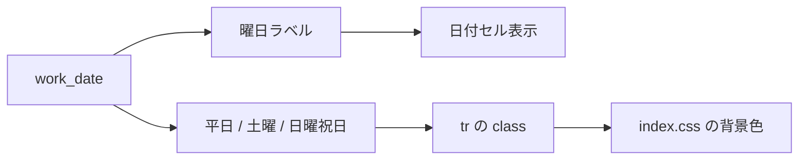

# 実装計画書 ― 曜日表示と土日祝の色

- 案件名: 曜日表示と土日祝の色
- 作成日: 2026-11-19
- フェーズ: Plan（実装はこの文書の Phase / Step に従う）
- 仕様ソース: 同フォルダの `要件定義書.md`（唯一）
- 対象リポジトリ: wizway-kintai-demo

この案件では OpenSpec の change／specs は作らない（要件の対象外）。  
Build 開始後は、この文書の Phase / Step を上から順に進める。  
各 Step の完了時に、下のチェックリストを `- [x]` にする。

## 検証の理想パス

実装・ローカル確認のあとは、次の順を理想とする。前が通ってから次へ進む。

1. **ローカル E2E** … `npm run pw:test:attendance`（`PLAYWRIGHT_BASE_URL` 無し。webServer が API + Vite を起動）
2. **AWS デプロイ** … 学習用アカウントのみ。指示が出てから。`deploy-jisseki` プロファイル
3. **AWS E2E** … CloudFront を向けて同じ Playwright を回す  
   `$env:PLAYWRIGHT_BASE_URL='https://d266q7koncqwt6.cloudfront.net'; npm run pw:test:attendance`

ローカル E2E が赤のままデプロイしない。AWS 載せ直しは指示があるまで行わない。

## タスクチェックリスト

### Phase 1: 画面の補助関数とスタイル

- [x] Step 1-1: 曜日・祝日判定のヘルパ（`frontend/src/App.tsx` または近傍）
- [x] Step 1-2: 土日祝の行背景色（`frontend/src/index.css`）

### Phase 2: 日付列への反映

- [x] Step 2-1: 日付セルの曜日表示と行クラス（`frontend/src/App.tsx`）

### Phase 3: テスト・受け入れ

- [x] Step 3-1: ローカル E2E（曜日・土日祝の印を確認。日付セル exact を更新）
- [x] Step 3-2: 受け入れの目安 1〜4（ローカル画面または E2E）
- [x] Step 3-3: AWS デプロイ（フロント S3 sync + CloudFront invalidate。`deploy-jisseki`）
- [x] Step 3-4: AWS E2E（CloudFront 向け。終わったら共有 DB をシードに戻した）

## 方針サマリ

画面だけで曜日と土日祝の見た目を足す。  
API・DB・合計・CSV・保存バリデーションは触らない。外部の祝日パッケージも足さない。

## 変更ファイル一覧

| ファイル | 変更の有無 | 方針 |
|----------|------------|------|
| `frontend/src/App.tsx` | あり | 曜日ラベル、祝日一覧、行 class、日付セル文言 |
| `frontend/src/index.css` | あり | `.row-saturday` / `.row-holiday` の背景色 |
| `tests/e2e/attendance.spec.ts` | あり | 日付セルの exact を新文言に合わせ、土日祝の印を1ケース以上 |
| `backend/**` | なし | API／DB 不変 |
| `sql/**` | なし | スキーマ不変 |
| `template.yaml` | なし | 新リソースなし |

## ファイルごとの方針

### 画面（`frontend/src/App.tsx`）

- `WEEKDAY_LABELS = ['日','月','火','水','木','金','土']`
- `formatWorkDateLabel(workDate)` → `YYYY-MM-DD（曜）`
- `JP_HOLIDAYS_2026` など、少なくとも 2026 年の国民の祝日（振替・国民の休日含む）を `Set` で持つ
- `rowKind(workDate)` → `'weekday' | 'saturday' | 'holiday'`  
  - 日曜または祝日 → `holiday`  
  - 土曜（祝日でない）→ `saturday`  
  - それ以外 → `weekday`
- `<tr className={...}>` に `row-saturday` / `row-holiday` を付ける（平日は追加なしでよい）
- 日付セルは `{formatWorkDateLabel(row.work_date)}`
- `aria-label` と保存ボタン文言は `YYYY-MM-DD` のまま

### スタイル（`frontend/src/index.css`）

- `tr.row-saturday { background: #e8f1fb; }`
- `tr.row-holiday { background: #fdecee; }`
- 入力欄の白背景は維持してよい（行全体が薄い色で識別できれば足りる）

### E2E（`tests/e2e/attendance.spec.ts`）

- `getByRole('cell', { name: '2026-11-21', exact: true })` など日付 exact は、新文言（例: `2026-11-21（土）`）に更新する
- 曜日・土日祝の確認ケースを1つ以上足す（例: 11-02 に `（月）`、11-07 に `row-saturday`、11-03 に `row-holiday`）

## 処理フロー（正常系）

1. 月取得で得た各行の `work_date` を画面が持つ（既存）
2. 日付セル描画時に曜日を付与する
3. 同じ `work_date` で土日祝判定し、`<tr>` に class を付ける
4. CSS が背景色を出す

## 例外フロー

| 条件 | 期待 |
|------|------|
| `work_date` が不正で Date が取れない | その行は曜日なし・特別 class なし（通常は API が正しい日付だけ返す） |
| 祝日一覧に無い年 | 土日だけ色付け。祝日扱いにはしない |

## テスト観点

- 2026-11-02 → `2026-11-02（月）`
- 2026-11-07 → 土曜 class
- 2026-11-01 → 日曜・祝日 class
- 2026-11-03 / 2026-11-23 → 日曜・祝日 class（祝日）
- 既存ログイン・保存・合計の E2E が緑

## 受け入れの目安（要件より）

1. サンプル海原でログインし、2026-11 の表で各日に曜日が見える
2. 土曜の行と日曜の行の背景色が、平日と違う
3. 2026-11-03 と 2026-11-23 の行の背景色が、平日と違う（祝日）
4. 区分・出勤などの入力と保存は、これまでどおり動く

## 触らないもの

- 出勤／退勤の時刻選択、休憩長さのタイマー選択
- API／DB／CSV／合計／OpenSpec
- 研修用リポ `wizway-kintai-demo-20261121`
- 本番勤怠・本番 AWS
- 指示の無い AWS 載せ直し

---

## Phase / Step（詳細）

### Phase 1: 画面の補助関数とスタイル

#### Step 1-1: 曜日・祝日判定のヘルパ

- 編集対象: `frontend/src/App.tsx`
- 完了条件: `formatWorkDateLabel` / `rowKind` / 2026 年祝日一覧があり、単体で正しいラベルと kind を返せる

#### Step 1-2: 土日祝の行背景色

- 編集対象: `frontend/src/index.css`
- 完了条件: `.row-saturday` と `.row-holiday` の背景色がある

### Phase 2: 日付列への反映

#### Step 2-1: 日付セルの曜日表示と行クラス

- 編集対象: `frontend/src/App.tsx`
- 完了条件: 日付セルが `YYYY-MM-DD（曜）`。土日祝の `<tr>` に class。`aria-label`／保存ボタンは日付のみ

### Phase 3: テスト・受け入れ

#### Step 3-1: ローカル E2E

- 編集対象: `tests/e2e/attendance.spec.ts`
- 完了条件: 日付セル更新と土日祝の印のケースがあり、`PLAYWRIGHT_BASE_URL` 無しで `npm run pw:test:attendance` が緑

#### Step 3-2: 受け入れ確認

- 編集対象: なし
- 完了条件: 受け入れの目安 1〜4 を満たす（E2E で代替可）

#### Step 3-3: AWS デプロイ

- 編集対象: なし
- 前提: Step 3-1 が緑、かつ載せ直しの指示があること。プロファイルは `deploy-jisseki`
- 完了条件: 見本スタックへフロントを載せた

#### Step 3-4: AWS E2E

- 編集対象: なし
- 前提: Step 3-3 完了
- 完了条件: CloudFront 向け `npm run pw:test:attendance` がパス
